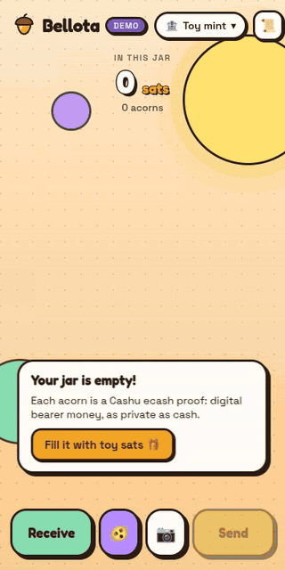

# 🌰 Bellota — a 3D Cashu wallet

> Your sats are acorns that drop into a jar.

**Bellota** (Spanish for *acorn*) is a web wallet for [Cashu](https://cashu.space) — ecash for Bitcoin — where every *proof* is a physical 3D acorn coin. Receive over Lightning and they drop into the jar; send ecash and they fly out; pay an invoice and they melt into a lightning bolt. Cartoon look (cel shading + ink outlines) with a modern neo-brutalist interface.

**▶ Try it: [negr087.github.io/bellota](https://negr087.github.io/bellota/)** · [offline demo mode](https://negr087.github.io/bellota/?demo)

<p align="center">
  
  <br />
  <sub>Demo mode, recorded in a headless browser · <a href="docs/demo.mp4">MP4 version</a></sub>
</p>

Built for the **[Nut November 2026](https://nutnovember.org)** hackathon · #NutNovember

## Features

| | |
|---|---|
| ⚡ → 🌰 **Receive over Lightning** | Creates an invoice (NUT-04), waits for payment and mints the acorns. Pending invoices keep being checked even if you close the app. |
| 🌰 **Claim ecash** | Paste a `cashuA…`/`cashuB…` token to see the amount, mint and memo before claiming. Unknown mints are flagged and added. |
| 🌰 → 🎁 **Send ecash** | Builds a token (with an optional note) as text + QR. From your history you can check whether it was claimed (NUT-07) and **reclaim** it if not. |
| 🥜 **Send as emoji or GIF** | Share a token hidden **inside an emoji** (🥜 + invisible Unicode variation selectors, the same scheme as cashu.me, so they interoperate both ways) or as an **animated GIF**. The GIF carries the token twice: as a QR code that survives chat-app recompression and any wallet can scan, and verbatim in a GIF comment block for lossless import. Bellota claims tokens from a pasted emoji, or from a GIF, screenshot or photo you open, paste or drop. Hidden, not encrypted. |
| 🌰 → ⚡ **Pay Lightning** | Quotes the invoice (NUT-05) showing amount + fee reserve, pays, and keeps the change (NUT-08). |
| 📧 **Lightning Address & LNURL** | Pay `user@domain` (LUD-16) or an `lnurl1…` QR (LUD-01/06): shows what the recipient accepts, supports comments (LUD-12) and **checks the invoice is for the exact amount** before paying. |
| 📷 **QR scanner** | A dock button reads any QR and routes it: Cashu token → claim; invoice, Lightning Address, LNURL or unified `bitcoin:…?lightning=` → pay. Works on iOS and Android, with a torch toggle when available. |
| 🌱 **12-word seed (NUT-13)** | Every proof is derived from a BIP-39 seed, so your 12 words restore your balance in another browser. Restore walks every keyset of each mint (NUT-09) and keeps what's unspent (NUT-07). Counters are persisted *before* each operation so they're never reused. Uses the standard NUT-13 derivation, so the words should also work in other NUT-13 wallets. |
| ⏳ **Crash-safe payments** | Before paying, proofs are saved as "in transit". If you close the tab or the payment stays pending, the app asks the mint (NUT-05/07) when you come back and returns whatever wasn't spent. |
| 📲 **Installable PWA** | Add it to your home screen (Android, iOS, desktop). A small service worker caches the app so it opens offline; mint and Lightning Address traffic is never cached. |
| 🔗 **Deep links** | `…/bellota/?scan=<token or invoice or address>` opens straight to claim or pay, and the app registers as a `web+cashu:` handler. |
| 🎨 **Themes & jars** | ⚙️ Settings lets you pick a background theme (Paper, Night with stars and fireflies, Snowfall, Orange pill sunburst, Autumn leaves) and a jar (acorn cap, mason jar, honey pot, cork bottle). Every jar shares the same physics. The Night theme also turns the whole interface dark. |
| 🔊 **Sound & haptics** | Optional, synthesized with Web Audio (no audio files): coins clink on real physics collisions (louder for harder hits, lower for bigger coins), a chime when sats arrive, a whoosh when you send, a zap when you pay. Vibration patterns for each event on Android. Toggle both in ⚙️. |
| 🏦 **Multi-mint** | Each mint is its own jar. Add, switch and remove mints. |
| 🔐 **Token backup** | Also exports one token per mint with the whole balance. |
| 👋 **First-run intro** | Three quick cards: what ecash is, an interactive splitter that turns any amount into its power-of-2 acorns (1,337 = 1,024 + 256 + 32 + 16 + 8 + 1), and a choice between the demo and real mints. Replay it from 🏦 → *How it works*. |
| 🧸 **Demo mode** | An offline toy mint to try the experience without real sats. |

### The 3D jar

- Each **proof** is a coin. Cashu splits amounts into powers of 2, so an acorn's size and color tell you its value: copper (1–2), amber (4–16), gold (32–128), mint (256–2048), grape (4096+).
- Real physics (Rapier): coins fall, bounce and pile up.
- Tap an acorn to see its value; tap the jar (or 🫨) to shake it.
- The lid is a little acorn cap that pops open when coins come in or go out.
- A hand-drawn loader (acorns dropping into a jar) shows from the first paint until the 3D has actually drawn its first frame.
- If the browser has no WebGL, the wallet still works without the 3D.

## Run it

```bash
npm install
npm run dev          # http://localhost:5173
npm run build        # production build in dist/ (Vercel, Netlify, GitHub Pages…)
npm run build:demo   # a single self-contained index.html in demo mode (dist-demo/)
```

Add `?demo` to the URL to jump straight into demo mode.

By default it uses **testnut.cashu.space**, a test mint with fake sats where invoices pay themselves — perfect for trying things out. For real sats, add a mint such as `mint.minibits.cash/Bitcoin` from 🏦.

Every push to `main` deploys to GitHub Pages via `.github/workflows/deploy.yml`.

## Stack

- React 18 + Vite (plain JavaScript)
- [`@cashu/cashu-ts`](https://github.com/cashubtc/cashu-ts) v4
- [`@scure/bip39`](https://github.com/paulmillr/scure-bip39) for the seed words
- [`qr-scanner`](https://github.com/nimiq/qr-scanner) (only loaded when the camera opens)
- [`gifenc`](https://github.com/mattdesl/gifenc) for the token GIFs (only loaded when you make one)
- three.js + @react-three/fiber + drei + @react-three/rapier
- Fredoka + Space Grotesk (bundled, no CDNs)

```
src/
  lib/cashu.js       real backend (cashu-ts): mint, melt, send, receive, states, restore
  lib/demo.js        same interface, backed by an in-memory toy mint
  lib/useWallet.js   state, persistence (localStorage) and actions
  lib/seed.js        BIP-39 seed and persistent NUT-13 counters
  lib/lnurl.js       Lightning Address / LNURL-pay (bech32 included)
  lib/emoji.js       tokens hidden in an emoji (variation selectors)
  lib/gif.js         token → animated GIF with QR + comment block (lazy-loaded)
  lib/imageToken.js  reads a token from a GIF comment or the QR in any image
  lib/parse.js       recognizes tokens, invoices, addresses and bitcoin:/lightning:/cashu: URIs
  three/             jar, coins, physics, toon materials and outlines
  ui/                receive / send / mints / history / seed sheets, QR scanner
```

## ⚠️ Warnings

- This is experimental hackathon software: **use small amounts**.
- Your ecash lives in the browser's `localStorage`. If you clear site data, only your 12 words can bring it back: **write them down**.
- The seed and proofs are stored unencrypted in the browser: anyone with access to your browser can read them.
- Cashu is custodial: the mint holds the sats. Pick mints you trust.

## Roadmap

- Encrypted proofs on Nostr (NIP-60) and receiving nutzaps (NIP-61)
- Payment requests (NUT-18)
- Animated (UR) QR codes for very large tokens
- PIN / passphrase to encrypt the seed at rest

## License

MIT © 2026 Sebastián ([@negr0](https://njump.me/negr0) on Nostr)
